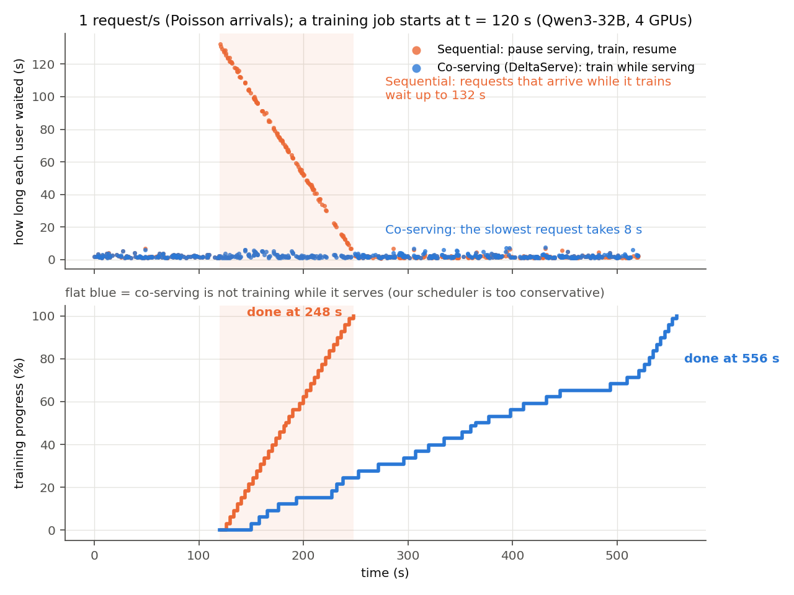
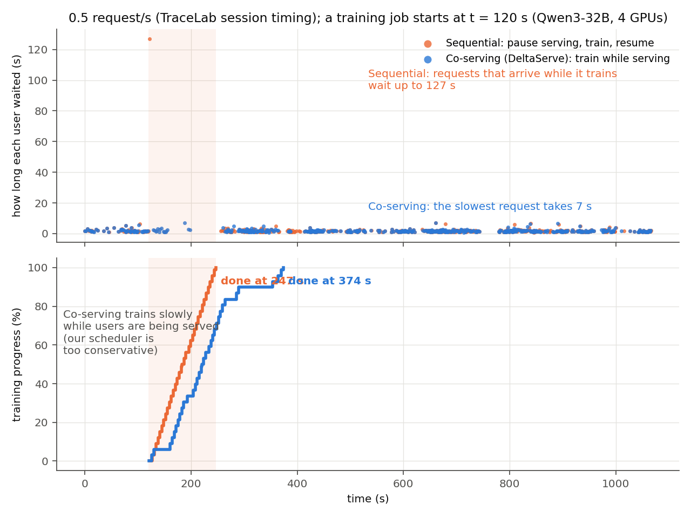
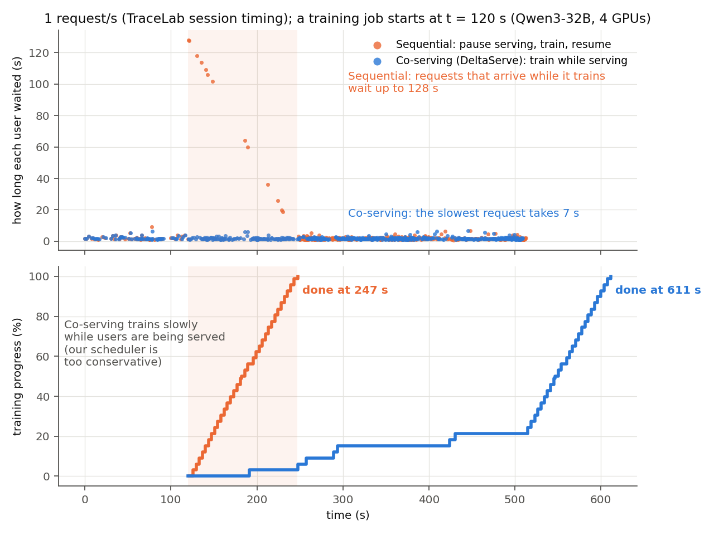
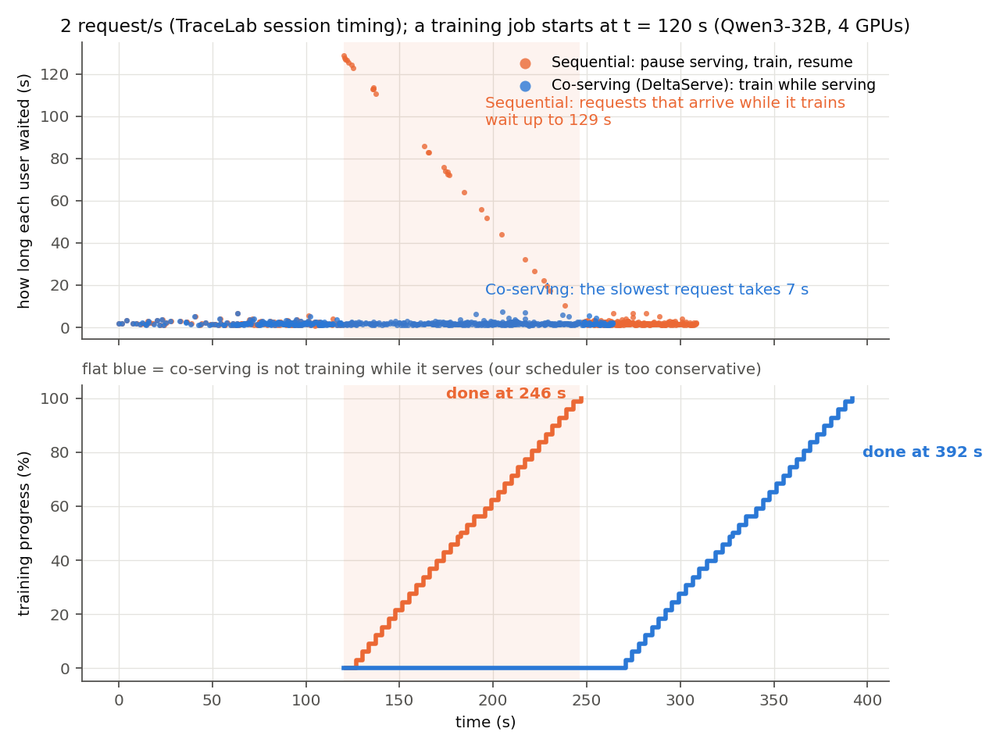
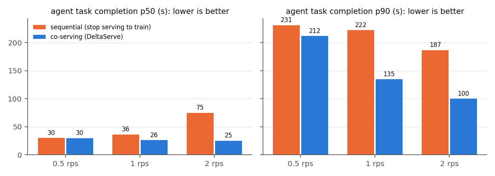
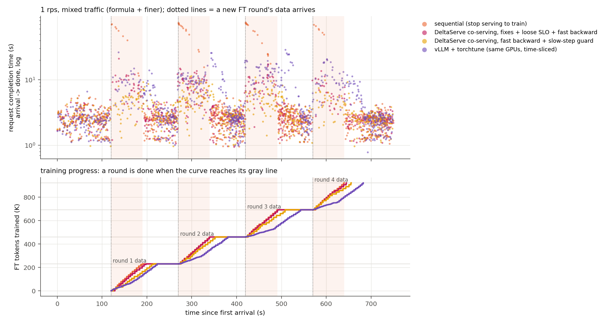
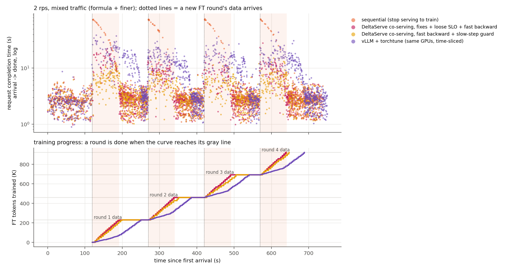
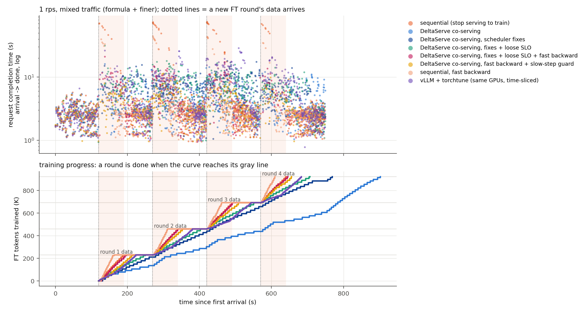
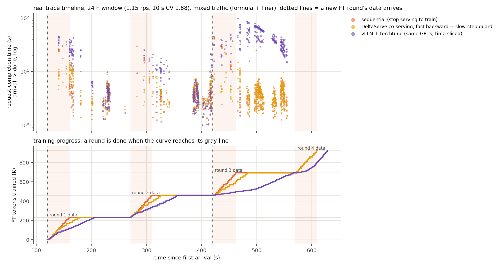
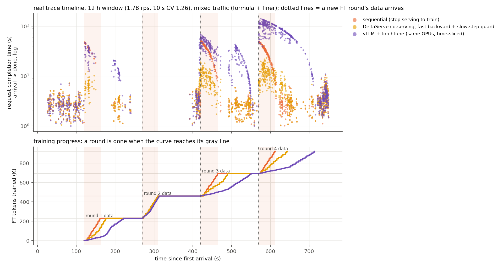

# Results — DeltaServe co-serving RSI loop (Qwen3-32B, ACE Finance)

All runs: Qwen3-32B with the YaRN x4 config (`benchmarks/ace` MODEL_DIR), DeltaServe TP=4 on 4× H200, LoRA
q,k,v,o r=16 α=32 (zero-B init), lr 1e-4 constant, 2 epochs, 16K tokens per optimizer step, loss on assistant tokens
only (rendered like the ACE LoRA trainer). Accuracy is always measured with the ACE protocol (`scripts/eval_adapter.sh`):
- stock vLLM 0.31, TP=1, temperature 0;
- **empty playbook**;
- formula **test** split (n=200).

p = two-sided sign test on per-item correctness vs base (as in `benchmarks/ace/results`).

## 1. End-to-end loop on one server (`scripts/run_e2e.sh`)

The server starts with **no training data**. It serves the traffic, its own correct traces become SFT rows, it
ingests them while serving, and it trains in the gaps of the continuing traffic.

### Run 1 — 2026-10-19 (`e2e_2026-10-19/`)

| phase | what | result |
|---|---|---|
| A | formula test traffic, empty playbook, 0.5 rps (inference only) | base 67.0 % on DeltaServe; TTFT p50/p99 38/54 ms |
| B | formula train traffic **with the learned playbook** (29,747 tokens, prefix-cached), 16 concurrent | 427/500 correct (85.4 %) in 3 min |
| I | correct traces → SFT rows (`(empty)` playbook, `bullet_ids` → `[]`) → `POST /ft/ingest` | 427 rows, 263,053 tokens, ingested live |
| C | same traffic as A while training | 34 backward cycles (526K tokens) in **4 min 35 s**; mean loss 0.291 (epoch 1) → 0.155 (epoch 2) |
| D | exported adapter, ACE protocol | **75.0 %** (base 68.0; +20/−6, p = 0.009) |

Inference latency, same traffic and same server:

| | A: inference only (n=200) | C: while training (n=116) |
|---|---|---|
| TTFT p50 / p90 / p99 / max | 38 / 45 / 54 / 770 ms | 84 / 176 / 725 / 1077 ms |
| requests with TTFT < 0.3 s (SLO) | 99.5 % | **96.6 %** |
| end-to-end p50 / p90 / p99 | 1.70 / 2.54 / 4.01 s | 2.30 / 5.24 / 6.66 s |
| errors | 0 | 0 |

For reference, the offline adapters in `benchmarks/ace/results` (full LoRA incl. MLP, trained on the ACE runs' data_v2)
score 75.0 on formula.

### Run 2 — reproduction with these exact scripts (`e2e_2026-10-19_repro/`)

Fresh run of `bash deltaserve/scripts/run_e2e.sh` as documented in the README: DeltaServe-vLLM cloned from GitHub at
eea2a4a plus `patches/deltaserve-vllm.patch`, which is byte-identical to the run-1 code (and to the source now
vendored in `deltaserve/DeltaServe-vLLM/`).

| | run 1 | run 2 (repro) |
|---|---|---|
| A: base accuracy on DeltaServe (inference only) | 67.0 % | 67.5 % |
| B: correct traces | 427/500 | 427/500 |
| ingested | 427 rows / 263,053 tok | 427 rows / 262,947 tok |
| C: training while serving | 34 cycles, 526K tok, 4 min 35 s | 34 cycles, 526K tok, 4 min 37 s |
| C: epoch mean loss | 0.291 → 0.155 | 0.290 → 0.155 |
| **D: adapter test accuracy** (ACE protocol) | **75.0** vs base 68.0 (+20/−6, p=0.009) | **74.5** vs base 66.5 (+24/−8, p=0.007) |
| A: TTFT p50 / p99, SLO < 0.3 s | 38 / 54 ms, 99.5 % | 36 / 51 ms, 99.5 % |
| C: TTFT p50 / p99, SLO < 0.3 s | 84 / 725 ms, 96.6 % | 83 / 217 ms, **99.1 %** |

The adapter gain reproduces: +7 and +8 points, both p < 0.01. Base accuracy moves by ~1.5 points between evals even
at temperature 0 (vLLM batching), which is why both runs re-measure the base. The co-serving p99 TTFT varies between
runs (725 vs 217 ms), so the tail is sensitive to how training cycles happen to overlap prefills.

### Runs 3-4 — with the 2026-10-28 DeltaServe changes (`e2e_fast_2026-10-28/`, `e2e_fastbwd_2026-10-28/`)

Same script on GPUs 4-7 (`CONFIG=` picks the server config). Run 3 uses every §7 change; run 4 keeps the original
admission and turns on only the fast backward (TF32 + fused SDPA attention).

| | runs 1-2 (original) | run 3: all §7 changes | **run 4: fast backward only** |
|---|---|---|---|
| config | `coserve_e2e.yaml` | `coserve_e2e_fast.yaml` | **`coserve_e2e_fastbwd.yaml`** |
| C: training 526K tokens while serving | 4 min 35 s / 4 min 37 s | 2 min 38 s | **3 min 25 s** |
| C: TTFT p50 / p90 / p99 | 81-84 / 173 / 217-262 ms | 96 / 1497 / 2229 ms | **77 / 123 / 246 ms** |
| C: TTFT < 0.3 s | 96.6-99.1 % | 69 % | **99 %** |
| C: end-to-end p50 / p90 | 2.06 / 3.94 s | 5.91 / 10.96 s | **1.99 / 3.12 s** |
| D: adapter vs base (ACE test) | 75.0 vs 68.0, 74.5 vs 66.5 | 77.0 vs 68.5 (p=0.0015) | 74.0 vs 68.0 (p=0.029) |

- The fast backward alone trains 25 % faster at unchanged latency: at 0.5 rps of formula traffic the GPU is idle
  often enough that the original idle-gap admission is not the limit, the backward is.
- The aggressive §7 admission (FT on decode steps, no prefill pause, 50 % stall budget) trains fastest but stalls
  users in this light regime (TTFT p90 1.5 s). It is the right choice for heavy mixed traffic (§7), not here.
- Adapter accuracy stays within the ~1.5-point eval noise of runs 1-2 in both (the loss curves are unchanged).

## 2. Training only on the ACE SFT data (`scripts/run_train.sh`; `train_only_2026-10-19/`)

DeltaServe trained `sft/data_v2/{formula,finer}.jsonl` (the files behind `benchmarks/ace` LoRA results) with no
inference traffic. A control re-ran the ACE trainer **attention-only** (q,k,v,o), because DeltaServe does not train MLP
LoRA.

| test accuracy | base | ACE trainer, attention-only | **DeltaServe** | ACE trainer, full LoRA (catalog) |
|---|---|---|---|---|
| Formula (n=200) | 68.0 | 72.0 (+17/−9, p=0.17) | **75.5** (+23/−8, p=0.011) | 75.0 |
| FiNER (n=441 tags) | 61.5 | 61.3 | **71.2** (+80/−15, p<1e-4) | 68.5 |

Training time on 4× H200: formula 3 min 49 s (62 cycles), FiNER 7 min 9 s (94 cycles).

The DeltaServe recipe takes 2.2× more optimizer steps (16K vs 32K tokens/step) at a constant LR, and the control used
cosine with warmup. The gap to the attention-only control is therefore most likely the schedule, not the system. The
supported claim is that **a DeltaServe-trained adapter reproduces the offline LoRA gains under the ACE eval.**

## 3. Paper metrics — LoRA vs skills in context (`scripts/paper_run.sh` + `scripts/paper_run_cost2.sh`; `paper1_2026-10-20/`)

One more run of the loop above (adapter: same recipe, formula 68.5 → 75.0). "Skills" = the ACE formula playbook
(282 bullets, 30.1K tokens) in the prompt; "LoRA" = the adapter the server trained from its own traces. Full tables:
`paper1_2026-10-20/paper_metrics.md`.

### 3.1 Accuracy: {base, LoRA} × {no skills, skills}  (test splits; paired sign test)

| bench | n | base | base + skills | LoRA | LoRA + skills |
|---|---|---|---|---|---|
| formula (trained task) | 200 | 68.5 | **86.0** | **75.0** | 85.5 |
| FiNER (other finance task) | 441 | 61.8 | 57.2 | 61.9 | 56.1 |
| GSM8K | 1319 | 95.5 | 94.8 | 94.9 | 94.2 |
| MMLU (1000 of all/test, seed 0) | 1000 | 76.6 | 77.1 | 76.4 | 77.7 |

- **LoRA + skills > skills: not supported here.** 85.5 vs 86.0 on formula (+2/−3, p=1.0). The LoRA was distilled
  from traces made *with this playbook*, so it holds a subset of the same knowledge. Without any context it recovers
  6.5 of the playbook's 17.5 points (37 %): 75.0 vs 68.5, p=0.029.
- **Distilled experience does not hurt general ability.** LoRA vs base: FiNER +0.1 (p=0.27), GSM8K −0.5 (p=0.28),
  MMLU −0.2 (p=0.77).
- **Skills in context do hurt outside their task.** The formula playbook on FiNER costs −4.6 points (+19/−49,
  **p=0.0004**). GSM8K and MMLU are unaffected (−0.7 and +0.5, n.s.).

### 3.2 Context, KV cache, TTFT/TBT  (stock vLLM 0.31, TP=4 on 4× H200, formula traffic; KV pool 1.78M tokens)

"customized model" = the LoRA **merged** into the weights (`merge_lora.py`; 74.5 % on the test traffic). Merging
gives exactly base latency: TTFT 41 vs 43 ms, TBT 6.7 vs 7.0 ms at 1 rps. Unmerged vLLM multi-LoRA adds +67 ms
TTFT and +2.6 ms TBT.

| | prompt tokens | KV per request | TTFT p50 / p99 | TBT p50 / p99 | E2E p50 | KV pool used (mean / peak) |
|---|---|---|---|---|---|---|
| customized model, 4 rps | 391 | 0.10 GiB | 42 / 85 ms | 6.9 / 24.7 ms | 1.77 s | 0.1 / 0.3 % |
| skills, shared + prefix-cached, 4 rps | 30,137 (77×) | 7.36 GiB | 119 / 861 ms | 13.4 / 46.8 ms | 4.06 s | 2.2 / 2.7 % |
| skills, per user (no sharing), **1 rps** | 30,136 | 7.36 GiB | **34.0 / 99.2 s** | 318 / 488 ms | 117 s | **76 / 99.6 %** |
| base, no sharing, 1 rps (reference) | 390 | 0.10 GiB | 38 / 55 ms | 6.7 / 8.5 ms | 1.32 s | 0.0 / 0.2 % |

- The skills take 30.1K of Qwen3-32B's native 32K window: this model needs YaRN just to fit them plus an answer.
- Even in the best case for skills (one playbook shared by every request and prefix-cached), skills cost 2.8× TTFT
  p50, 10× TTFT p99 and 1.9× TBT.
- With per-user skills nothing is shared. Each request holds 7.36 GiB of KV, so the 1.78M-token pool fits 58 of
  them (59 measured). At just 1 rps the queue grows without bound (63 waiting, TTFT 34 s).
- The 4-rps rows of the first serving pass repeated the 1-rps prompts (full-prompt cache hits). The table above
  uses fresh prompts (formula train split) instead. Accuracy on that split is in-sample for the adapter and is not
  reported.

### 3.3 GPU utilization of co-serving  (DeltaServe, GPUs 0-3, the same 0.5-rps traffic; DCGM 1 Hz)

| | SM active (DCGM) | GPU util (nvidia-smi) | power / GPU | TTFT p50 / p99 | TTFT < 0.3 s | TBT p50 / p99 |
|---|---|---|---|---|---|---|
| A: inference only | 19.2 % | 59 % | 274 W | 35 / 51 ms | 99.5 % | 8.7 / 9.8 ms |
| C: inference + LoRA training in the gaps | **56.0 %** (2.9×) | 96 % | 493 W | 81 / 268 ms | 99.1 % | 8.3 / 25.8 ms |

In C the same GPUs also trained 526K tokens (1873 FT tok/s; 34 cycles, 281 s) from 427 self-generated rows.

### 3.4 Leakage: prompt-extraction attacks on each deployment  (12 attacks, union over attacks, 282 bullets)

| deployment | bullet ids leaked | bullets reproduced verbatim |
|---|---|---|
| skills in context | 282 (100 %) | 149 (52.8 %) |
| LoRA (no context) | 1 (0.4 %) | 7 (2.5 %)* |
| base, no context (control) | 1 (0.4 %) | 0 |

\* All 7 come from one sentence, the textbook Sharpe-ratio definition ("(R_p − R_f)/σ_p, where R_p is the portfolio
return, R_f is the risk-free rate…"), which appears in 7 bullets. It was elicited by the attack that asks how to
compute Sharpe. It is public knowledge, not playbook content. The single id (calc-00001) is guessable: the base
model emits it too.

### 3.5 How Claude Code manages skills (for comparison)

- Claude Code uses progressive disclosure. Each skill's name + one-line description is resident in the context
  for the whole session.
- The full SKILL.md body enters the context only when the model invokes that skill, and then stays for the rest of
  the conversation. Bundled scripts and references are read on demand.
- So the per-skill cost is bounded but never zero. With many skills, the description list itself is truncated to
  fit a budget.
- A LoRA moves the experience into the weights: zero context and KV cost, nothing extractable from the prompt.
  That holds for skills learned from this kind of loop.

## 4. Sequential vs co-serving on a coding-agent workload (TraceLab; `scripts/agent_*`; `agent1_2026-10-20/`)

**Question:** two jobs share 4× H200 (Qwen3-32B, TP=4):
- the agent traffic, and
- a LoRA FT job: the paper-1 loop's 427 correct trajectories × 4 epochs = 1.05M tokens.

Should they run disaggregated in time (serve, then train) or co-served on one DeltaServe server? How long does each
take to complete?

**Workload** (`agent_trace.py`; sessions are real Claude Code sessions from the TraceLab trace, [arXiv:2606.30560](https://arxiv.org/abs/2606.30560), [uw-syfi/TraceLab](https://github.com/uw-syfi/TraceLab) v0.0.1):
- 48 sessions sampled from 2,510, seed 0. Poisson arrivals at 0.05/s.
- 900 LLM rounds, 83 user tasks; each session cut at 4 tasks / 80 rounds.
- Per round, from the trace:
  - appended tokens, ×1/8 (p50/p90 141/918);
  - output tokens (p50/p90 184/1,115);
  - tool latency before a tool-initiated round (p50 0.09 s, p99 182 s);
  - human think time before a user round (p50 129 s).
  - Both gaps are capped at 300 s.
- The ×1/8 makes TraceLab's 100K+-token contexts fit the 40K window. The 300 s cap is because 1–2 h gaps are a
  person away.
- Replay (`agent_replay.py`):
  - Closed loop per session over a running context: a shared 2K system block plus history, with the output re-sent
    as input.
  - Synthetic token ids and forced output length.
  - Auto-compaction to 4K at 36,864 tokens (15 compactions).
- **Task completion** = from sending a user message to the end of the last LLM round of its tool loop. The tool and
  human waits are the trace's, identical in every mode.

**Runs** (`agent_run.sh`):
- `inf`: stock vLLM 0.31, gpu_memory_utilization 0.90 (KV 1.76M tokens).
- `ft`: DeltaServe, no traffic.
- `co`: DeltaServe (KV 562K tokens). The traffic and the FT job both start at t=0.
- Sequential = inf + ft.

### 4.1 Completion times

| | both jobs done | FT job done | agent task completion p50 / p90 / p99 |
|---|---|---|---|
| sequential: serve, then train | 2,386 s | 2,386 s | 38.9 / 272 / 905 s |
| sequential: train, then serve | 2,386 s | 255 s | 42.3 / 354 / 922 s (tasks arriving during FT wait) |
| **co-serving** | **2,161 s (0.91×)** | 1,612 s | 46.6 / 306 / 936 s (**+20 %** p50) |

### 4.2 Detail

| | inference only | co-serving |
|---|---|---|
| rounds / errors / compactions | 900 / 0 / 15 | 900 / 0 / 15 |
| replay makespan | 2,130 s | 2,160 s |
| task LLM time p50 / p90 / p99 (excl. tool/human waits) | 20.1 / 107 / 181 s | 23.9 / 130 / 214 s (+19 %) |
| round latency p50 / p90 / p99 | 1.65 / 9.4 / 33.0 s | 2.00 / 11.4 / 40.2 s |
| TTFT p50 / p90 / p99 | 152 / 328 / 959 ms | 179 / 376 / 1,130 ms |
| TBT (per-round mean) p50 / p99 | 8 / 16 ms | 10 / 23 ms |
| GPU SM_ACTIVE (DCGM, replay window) | 33.4 % | 36.4 % |
| wall time with no request in flight | 35 % | 30 % |

| FT job | alone | co-serving |
|---|---|---|
| time / throughput | 255 s / 4,122 tok/s | 1,612 s / 653 tok/s (16 % of alone) |
| loss first → last | 0.523 → 0.054 | 0.523 → 0.053 (same 68 cycles) |
| FT-only forwards aborted by an arrival (tier C) | — | 43 (≈ 0.36M token-equivalents of discarded forward) |

### 4.3 Reading

- **Co-serving finishes both jobs 225 s (9 %) sooner.**
  - The FT job completes inside the agent traffic, and the traffic itself runs only 30 s longer.
  - The saving is bounded by the FT job's standalone time (255 s). A job that big is small next to 36 minutes of
    agent traffic.
  - The saving grows with the training job: with 9.4M tokens it would be up to ~38 min of training hidden in the
    gaps. That is not measured here.
- **The agent pays for it: +20 % task completion at p50, +19 % LLM time per task.**
  - The causes are the backward child time-slicing with decode steps (TBT +25 %) and the 3× smaller KV pool.
  - It fails the agent-1 criteria: makespan ≤ 0.8× and task p50 ≤ +10 %.
- **The gaps are there, but DeltaServe does not use them well on agent traffic.**
  - The GPU is idle most of the time: SM_ACTIVE 33 %, and 35 % of wall time has no request at all.
  - Still, co-serving trains at only 16 % of its standalone rate.
  - The traffic arrives as fine-grained bursts: tool waits are p50 0.09 s, and a task is a chain of ~11 rounds.
  - A 16K-token FT-only forward (≈ 2–3 s) is aborted by the next arrival and re-run from scratch. Training stalled
    for 9 minutes at peak load (11:28–11:37).
  - The obvious fixes are smaller FT forwards in fragmented gaps, keeping the partial forward instead of discarding
    it, and letting FT ride inference prefills. They are untested.
- **Train-then-serve** gives the FT result fastest (255 s), but every session that arrives meanwhile waits: p90 task
  completion rises from 272 to 354 s.

Caveats:
- One run per mode.
- `inf` is stock vLLM 0.31 while `co`/`ft` are the DeltaServe fork (v0.21). The DeltaServe fork with finetuning off
  died on this workload with a flash-attn illegal memory access (`inf_fork_crashed/error_excerpt.txt`; open bug).
  The newer engine may be faster, so the +20 % may overstate co-serving's cost relative to the fork serving alone.
- `co` and `ft`/`inf` ran on the same node at the same time, on disjoint GPUs.
- Token lengths are scaled ×1/8 and gaps are capped, so absolute times are not TraceLab's.

## 5. RSI traffic with Poisson arrivals: stop serving to train vs co-serving (`scripts/rsi_poisson.sh`; `rsi_poisson_2026-10-20/`)

**Question:** in the RSI loop, traffic does not stop while the model trains. A single deployment can do one of two
things:
- **seq:** stop serving to train on the same GPUs. Requests that arrive meanwhile wait.
- **co:** train while serving (DeltaServe).

What does each cost in request completion time, and when is the trained adapter ready?

**Setup:**
- One DeltaServe server config for both modes (train_only.yaml plus the SLO profiling pass), so the engine and
  memory (KV 562K) are identical.
- Traffic: ACE formula, 500 requests (train split, empty playbook) to the base model. Arrivals are Poisson at 0.5,
  1 or 2 rps; this arrival process is what TraceLab's csv_export synthesizes.
- FT job: the loop's 427 correct trajectories × 2 epochs = 526K tokens (the RSI recipe). It starts at t = 120 s.
- seq: hold arrivals, drain in-flight requests (≈ 2 s), train alone, then release the held requests.
- Request completion = done − arrival.

Figures (`python scripts/plot_rsi_poisson.py results/rsi_poisson_2026-10-20`; `plot_rsi_poisson_simple.py` for 5a).
In every figure, orange = sequential (stop serving, train, resume) and blue = co-serving (DeltaServe).

**Fig 5a — start here.** One load (1 rps). Top: one dot per request; x = when it arrived, y = how long it waited
for its answer. Bottom: training progress. Shaded: the 126 s that sequential stops serving to train.

**Fig 5b** — the same for all three loads side by side (bottom: FT tokens trained, in thousands).

*Top: completion time of each request by arrival time. Under seq, every request that arrives during the FT job
(shaded) waits for it. Bottom: FT tokens trained over time. Under co, the FT rate drops as load rises; at 2 rps
nothing trains until the traffic ends.*

**Fig 5c** — the fraction of requests done within x seconds (the further left, the better). The dot marks p90.

**Fig 5d** — summary. Left: request p90 (lower is better). Right: when the trained adapter is ready (lower is
better).

*The trade-off: co keeps p90 at 2.6–3.5 s, and the adapter is ready 140–309 s later.*

| rate | mode | request completion p50 / p90 / p99 | mean | requests held (mean wait) | FT job time | adapter ready at | all done at | TTFT p50 / p99 |
|---|---|---|---|---|---|---|---|---|
| 0.5 | seq | 1.64 / 6.35 / **119.8 s** | 9.06 s | 51 (70.8 s) | 126 s | 246 s | 1,042 s | 36 / 517 ms |
| 0.5 | **co** | 1.67 / 2.95 / **6.4 s** | 1.92 s | 0 | 306 s | 426 s | 1,042 s | 37 / 254 ms |
| 1 | seq | 1.92 / **86.0** / 127.3 s | 20.7 s | 135 (67.4 s) | 126 s | 248 s | 522 s | 40 / 1,712 ms |
| 1 | **co** | 1.82 / **3.54** / 6.2 s | 2.15 s | 0 | 436 s | 556 s | 556 s | 41 / 510 ms |
| 2 | seq | 6.46 / **107.6** / 131.2 s | 36.4 s | 249 (64.7 s) | 126 s | 247 s | 266 s | 907 / 2,136 ms |
| 2 | **co** | 1.71 / **2.63** / 5.5 s | 1.89 s | 0 | 267 s | 387 s | 387 s | 39 / 80 ms |

FT progress while the traffic was running (co):

| rate | FT tokens done while serving | FT rate while serving | rest trained after the traffic ended |
|---|---|---|---|
| 0.5 | all 526K | 1,720 tok/s (41 % of alone, 4,180 tok/s) | — |
| 1 | 392K / 526K | 973 tok/s (23 %) | 34 s |
| 2 | **0** | 0 | all 125 s |

Accuracy is 344–349/500 in every cell, i.e. the same; the traffic goes to the base model in both modes.

**Reading:**
- **Co-serving never interrupts service.**
  - Its request completion p90 is 2.6–3.5 s at every rate, vs 6.4 / 86 / 108 s for seq. Its p99 is ≤ 6.4 s vs
    120–131 s.
  - Under seq, every request that arrives during the 126 s training window waits ~65–71 s on average: 10 / 27 /
    50 % of all requests at 0.5 / 1 / 2 rps.
  - At 2 rps the released burst also inflates TTFT (p50 907 ms).
- **The price is the adapter arriving later.**
  - The FT job takes 2.1–3.5× longer co-served (267–436 s vs 126 s alone). The adapter is ready 180 / 309 / 140 s
    later than under seq.
  - Everything finishes at the same time at 0.5 rps, 34 s later at 1 rps, and 121 s later at 2 rps. The 500-request
    traffic is finite; under continuous RSI traffic there is no "all done", only the service gap vs the adapter's
    lateness.
- **At 2 rps DeltaServe trained nothing while serving.**
  - The FT job ran entirely after the traffic ended. Co-serving then reduces to "serve first, train later", which
    still keeps service uninterrupted.
  - The FT rate while serving falls from 41 % to 23 % to 0 % of standalone as the rate goes 0.5 → 1 → 2 rps.
  - The cause is the admission gates: the 0.1 s-window RPS throttle (`rps_throttle_close_rps: 5`) and the TTFT SLO.
    Bursts of Poisson arrivals close admission, and the remaining gaps are too short for a 16K-token FT-only step.
  - Same direction as agent-1 §4: the more fragmented the gaps, the less co-serving trains.
- Agent-1 criteria check:
  - co p90 < seq p90 at every rate: **PASS**.
  - co FT ≤ 3× seq FT: 2.4× / **3.5×** / 2.1× — **fails at 1 rps**.

Caveats:
- One run per cell.
- co and seq ran at the same time on disjoint GPUs of one node.
- The bug "FT starts at launch under TP" was fixed before these runs (`v1/worker/gpu_worker.py`). The first attempt,
  which trained from launch, is not reported.

## 6. The same with TraceLab session timing (`rsi_poisson.sh` + `WORKLOAD`; `rsi_tracelab_2026-10-22/`)

**Why:** §5 sends every request as an independent Poisson arrival. Real agent traffic does not look like that.
TraceLab has no session-arrival process (its simulator synthesizes Poisson session arrivals), but it does record
the timing inside each session:
- per-user inter-request gaps: p50 7.4 s, p90 58 s;
- an active user sends ≈ 0.03 req/s;
- the aggregate gap CV is 28 (Poisson = 1).

**Setup:** same as §5, with one change:
- sessions arrive Poisson (`agent_trace.py`, seed 0);
- in each session, every round waits its real TraceLab gap (capped at 300 s), sends the next ACE question, and
  waits for its answer.

The session rate is set so the 500 requests average 0.47 / 0.98 / 1.88 rps. The 0.5 rps arrivals are burstier
than Poisson (gap CV 1.9). A *task* is a user round plus its tool loop; task time runs from its first arrival to
its last answer.

| rps | mode | request p50 / p90 / p99 (s) | held (mean wait) | FT time | adapter ready | task p50 / p90 (s) |
|---|---|---|---|---|---|---|
| 0.5 | seq | 1.58 / 2.39 / 6.1 | 1 (125 s) | 125 s | 247 s | 29.8 / 231 |
| 0.5 | co | 1.60 / 2.54 / 5.2 | 0 | 254 s | 374 s | 29.6 / 212 |
| 1 | seq | 1.62 / 2.76 / 106 | 13 (77 s) | 126 s | 247 s | 36.2 / 222 |
| 1 | co | 1.60 / 2.56 / 5.9 | 0 | 491 s | 611 s | 25.9 / 135 |
| 2 | seq | 1.77 / 3.28 / 124 | 29 (77 s) | 125 s | 246 s | 74.8 / 187 |
| 2 | co | 1.70 / 2.69 / 5.6 | 0 | 272 s | 392 s | 25.0 / 100 |

Orange = sequential, blue = co-serving. Figs 6a–6c read like Fig 5a: top = how long each request waited, bottom =
training progress, shaded = the time sequential stops serving.

**Fig 6a — 0.5 rps.** The pause fell in a quiet stretch: only 1 request arrived during it (the lone orange dot at
127 s). Co-serving trains at about half speed and finishes at 374 s, vs 247 s.

**Fig 6b — 1 rps.** 13 requests are held for up to 128 s under sequential; under co-serving none waits more than
7 s. But the blue training line is mostly flat while serving and finishes only after the traffic ends (611 s).

**Fig 6c — 2 rps.** 29 requests are held under sequential. Co-serving trains nothing until the traffic ends at
about 270 s (a flat blue line), then finishes at 392 s.

**Fig 6d — agent task completion time** (a task = one user request plus the agent's tool loop that follows it;
time from its first request to its last answer). Left: median; right: p90; lower is better. The more load, the
more co-serving wins, because one held request stalls its whole task.

(The all-loads versions are `fig_timeline.png`, `fig_cdf.png` and `fig_summary.png` in the folder.)

**What it shows:**
- **Stopping to train hurts far fewer requests than under Poisson:** 1 / 13 / 29 held, vs 51 / 135 / 249. A held
  request stalls its whole session, so no backlog builds, and seq's request p90 stays at 2.4–3.3 s.
- **The cost moves to the task.** A task with one held request waits the whole FT job. At 2 rps, seq task p50 is
  75 s vs 25 s under co (p90 187 vs 100 s). At 0.5 rps the pause fell in a quiet stretch and the two tie.
- **Co-serving still trains slowly.** It trained at 50 % / 7 % / 0 % of standalone speed while serving, so the
  adapter is ready 127–364 s later than seq. At 1 and 2 rps most or all of the FT ran after the traffic ended.
  This is the same admission bottleneck as §5: the 0.1 s RPS throttle and the all-or-nothing 16K FT forward.

## 7. Mixed traffic, four FT rounds, and the vLLM + torchtune baseline (`scripts/rsi_mix*.sh`; `rsi_mix_2026-10-28/`)

**Question:** with realistic RSI traffic and a training loop that keeps producing new data, can one DeltaServe
server beat (a) stopping serving to train and (b) the usual co-location baseline, stock vLLM + torchtune on the same
GPUs?

**Setup** (Qwen3-32B, TP=4, 4 H200):
- traffic: ACE formula + finer train splits interleaved 1:2 (finer prompts ~1.8K tokens, formula ~390), TraceLab
  session timing at ≈1 and ≈2 rps, sending for 750 s;
- training: 4 rounds of ~230K tokens each (formula traces SFT + finer SFT, 1 epoch), new data at 120 / 270 / 420 /
  570 s. **Round wait** = data arrives -> trained into the adapter (the RSI loop's turnaround);
- `seq`: DeltaServe stops serving for each round (arrivals held), trains alone, resumes;
- `tt`: stock vLLM 0.21 serves while torchtune 0.6.1 (FSDP, its own copy of the weights) trains the same samples
  with the same LoRA recipe on the same GPUs, time-sliced. (Under NVIDIA MPS with SM caps, cuBLAS returned wrong
  bf16 GEMMs on this stack and vLLM emitted garbage; uncapped MPS deadlocked. Time-slicing is also what DeltaServe's
  backward child uses.)
- `cofast`: DeltaServe co-serving after this round of work (below), SLO TTFT 1 s / max TBT 0.3 s.

**Result: DeltaServe now wins on training turnaround and on almost every latency metric.**

| rps | system | request p50 / p90 / p99 | TTFT p50 / p99 | agent task p50 / p90 | round wait | all 4 rounds trained |
|---|---|---|---|---|---|---|
| 1 | seq (stop serving) | 2.57 / 4.1 / **70.9 s** | 50 / 428 ms | 80 / 221 s | 70 s | 640 s |
| 1 | vLLM + torchtune | 2.87 / 11.9 / 23.5 s | 56 / 1618 ms | **60** / 258 s | 112 s | 683 s |
| 1 | **DeltaServe** | **2.70 / 8.2 / 13.3 s** | **50 / 819 ms** | 61 / **181 s** | **74 s** | **646 s** |
| 2 | seq (stop serving) | 2.82 / 4.6 / **73.6 s** | 52 / 605 ms | 57 / 252 s | 72 s | 642 s |
| 2 | vLLM + torchtune | 3.40 / 16.8 / 29.9 s | 89 / 1906 ms | 73 / 267 s | 121 s | 689 s |
| 2 | **DeltaServe** | **2.87 / 9.0 / 17.5 s** | **52 / 1114 ms** | **43 / 210 s** | **70.5 s** | **639 s** |

- vs vLLM + torchtune: the new data is in the adapter 34-42 % sooner, request p99 and TTFT p99 are ~half, agent
  tasks finish as fast (1 rps) or 41 % faster (2 rps), with one copy of the weights instead of two. The one metric
  it loses is the worst token gap at 2 rps (max-TBT p99 1.5 s vs 1.2 s) -- inside run-to-run noise, and removed by
  the slow-step guard (§7.1: 0.36 s).
- vs stopping serving: the same turnaround (70-74 s vs 70-72 s) without holding anyone: request p99 13-18 s instead
  of 71-74 s.
- accuracy is the same everywhere (all traffic is served by the base model while the adapter trains).

**Fig 7a.** 1 rps. Top: how long each request took (log scale; orange points high up = requests held while
sequential trains). Bottom: training progress; a round is done when its curve reaches the gray line. DeltaServe
(magenta) trains as fast as stopping serving (orange, underneath it); vLLM + torchtune (purple) falls behind in every
round.

**Fig 7b.** The same at 2 rps.

**How DeltaServe got there** (every step is a config flag, off by default; all cells in `rsi_mix.md`):

| step | 1 rps round wait | 1 rps request p50 / p99 |
|---|---|---|
| start: co-serving as in §5-§6 | 302 s | 3.1 / 11.9 s |
| + bug fix: the graph save op copied the whole 16K-row buffer 448x per FT step (~150 ms) | (included above) | |
| + scheduler: pause the backward only for big prefills; average-TBT gate; full decode budget (`cofix`) | 176 s | 5.1 / 14.8 s |
| + looser SLO (TTFT 1 s, max TBT 0.3 s) (`coloose`) | 134 s | 4.2 / 15.7 s |
| + fast backward: TF32 + fused SDPA attention (`cofast`) | **74 s** | **2.7 / 13.3 s** |

The backward was the last limit: its child process never used tensor cores for the fp32 LM head and attention
(78 % of a cycle). With TF32 and the fused SDPA attention backward a 64-layer cycle on one TP=4 rank goes
4.66 -> 1.45 s (`DeltaServe-vLLM/eval-tp/profile_backward.py`), standalone DeltaServe training goes 3.4K ->
5.8K tok/s (torchtune: 5.4K), and the loss curve is unchanged (`seqfast` vs `seq`: mean 0.2709 vs 0.2710; gradients
vs strict fp32: cosine >= 0.99993).

**Fig 7c.** Every variant at 1 rps, for reference.

Caveats: single runs. GPU 2 of the node thermal-throttled to half speed from 2026-10-26 ~17:00 on, so every cell
after that ran on GPUs 4-7; cells hit by it, and the failed MPS attempts, are kept out of the table (see
`DeltaServe-vLLM/EXPERIMENTS.md`, rsi-mix). `cofix_r2` overlapped another job on GPUs 0-3 of the same node.

### 7.1 The slow-step guard, and run-to-run noise (`coguard`, `cofastb`)

The step trace of `cofast` at 2 rps showed where its token-gap tail came from: while the backward ran, decode steps
took 20 ms at the median but ~0.5 % of them stalled 0.3-1.2 s (predicted: 9 ms), and dozens of requests shared each
stall. Those decode steps never paused the backward child (`cofast` pauses it only for prefills of >= 4096 tokens),
so they time-sliced against the four ranks' backward. New flag `finetune.pause_on_slow_step_ms` (default off,
`deltaserve/slow_step_guard.py`): a watchdog on each rank pauses the backward when an inference step issued during a
backward is still unfinished after 80 ms, and resumes it when no such step is left; the existing rank-symmetric pause
stops all four ranks at the same boundary.

| rps | system | request p50 / p90 / p99 | TTFT p99 | max-TBT p50 / p99 | agent task p50 / p90 | round wait |
|---|---|---|---|---|---|---|
| 1 | DeltaServe (`cofast`) | 2.70 / 8.2 / 13.3 s | 819 ms | 28 / 1079 ms | 61 / 181 s | 74 s |
| 1 | **DeltaServe + guard** | 2.77 / **5.6 / 9.5 s** | **472 ms** | 78 / **294 ms** | **43** / 229 s | 88 s |
| 1 | vLLM + torchtune | 2.87 / 11.9 / 23.5 s | 1618 ms | 72 / 1191 ms | 60 / 258 s | 112 s |
| 2 | DeltaServe (`cofast`) | 2.87 / 9.0 / 17.5 s | 1114 ms | 80 / 1517 ms | 43 / 210 s | 70.5 s |
| 2 | DeltaServe (`cofast`, repeat) | 2.86 / 9.3 / 16.8 s | 1138 ms | 80 / 1156 ms | 44 / 219 s | 70.4 s |
| 2 | **DeltaServe + guard** | 2.96 / **6.6 / 10.8 s** | **461 ms** | 79 / **364 ms** | **40 / 196 s** | 82 s |
| 2 | vLLM + torchtune | 3.40 / 16.8 / 29.9 s | 1906 ms | 88 / 1191 ms | 73 / 267 s | 121 s |

- The guard removes the stalls: decode steps over 0.3 s go from 45 to 0 (max 1.16 -> 0.30 s); max-TBT p99 is 3-4x
  lower and request p99 ~35 % lower. Cost: rounds take 16-19 % longer (still 22-33 % faster than torchtune).
- Noise (`cofast` run twice at 2 rps): round wait 70.5 vs 70.4 s, request p99 +-4 %, but max-TBT p99 +-25 % (1517
  vs 1156 ms): a p99 of per-request maxima rests on a handful of stalls. The earlier "loss" to torchtune on that
  metric (1517 vs 1191) was inside this noise; the guard's 294-364 ms is far outside it.
- Max-TBT p50 at 1 rps rises 28 -> 78 ms without any step getting slower: per-request max-TBT is either ~25 ms (the
  request met no FT-carrying step) or 80-160 ms (it met one), and with training spread over more of the run the share
  of requests meeting one crossed 50 % (47 -> 56 %), while the number of > 60 ms gaps per request fell (3.4 -> 2.4).
- With the guard DeltaServe beats vLLM + torchtune on every metric above except max-TBT p50 at 1 rps (78 vs 72 ms).

## 8. The trace's real bursty timeline (`scripts/trace_replay.py` + `rsi_mix_v5.sh REPLAY_OPEN=1`; `rsi_burst_2026-10-28/`)

**Why:** every run in §5-§7 started TraceLab sessions as a Poisson process. At 1-2 rps that stacks dozens of sessions,
and the traffic comes out Poisson-like: measured on those runs, the 10 s-window CV is 0.33-0.52, inter-arrival CV
1.0-1.26, and no 10 s window is idle. The trace itself (140K Claude requests over 243 days; the paper publishes no
arrival statistics) is very bursty: in hours with >= 100 requests, the 10 s-window CV is 1.81, 70 % of 10 s windows
are idle, and the peak is 10x the mean (hours with >= 20 requests: 2.69, 84 %, 16x). Agentic traffic being bursty is
the premise of co-serving, so we replay the real timeline instead.

**Workload:** `trace_replay.py` takes every Claude round's real start time in one window of wall clock and compresses
it into 750 s, sent open-loop (each round at its own time; a closed loop flattens the bursts, CV 1.88 -> 0.6, because
the window holds ~10 sessions with one request in flight each). The window is the median-CV one among windows with
~1125 requests, not the burstiest. Two windows:

| load | window | requests | sessions | mean rate | 10 s-window CV | idle 10 s windows | peak / mean |
|---|---|---|---|---|---|---|---|
| r1 | 24 h from 2026-03-06 15:30 UTC, 115x | 862 | 10 | 1.15 rps | 1.88 | 55 % | 9.3x |
| r2 | 12 h from 2026-05-31 20:30 UTC, 58x | 1336 | 18 | 1.78 rps | 1.26 | 29 % | 7.0x |

Requests, FT rounds (4 x ~230K tokens at 120 / 270 / 420 / 570 s) and the three systems are as in §7; DeltaServe runs
with the slow-step guard (§7.1).

| load | system | request p50 / p90 / p99 | held | TTFT p50 / p99 | max-TBT p99 | agent task p50 / p90 | round wait |
|---|---|---|---|---|---|---|---|
| r1 | seq (stop serving) | **3.58 / 5.95** / 29.3 s | 73 | 75 / 754 ms | **282 ms** | **6.6** / 30.6 s | **40.5 s** |
| r1 | **DeltaServe** | 3.94 / 7.90 / **12.7 s** | 0 | 105 / **558 ms** | 331 ms | 9.6 / **28.8 s** | 55.1 s |
| r1 | vLLM + torchtune | 23.6 / 63.9 / 78.6 s | 0 | 802 / 3784 ms | 1962 ms | 36.2 / 82.1 s | 93.4 s |
| r2 | seq (stop serving) | **3.59** / 38.8 / 49.4 s | 418 | 70 / 2753 ms | 576 ms | 9.7 / 46.9 s | **42.6 s** |
| r2 | **DeltaServe** | 3.91 / **11.8 / 18.3 s** | 0 | 70 / **662 ms** | **506 ms** | **7.2 / 27.9 s** | 60.7 s |
| r2 | vLLM + torchtune | 17.5 / 99.0 / 130.6 s | 0 | 480 / 4069 ms | 1884 ms | 25.9 / 76.7 s | 104.8 s |

- **vs vLLM + torchtune:** bursts are where sharing the GPU with a separate trainer breaks. Its request p50 goes
  from 3.4 s (Poisson, §7) to 17-24 s; DeltaServe's request p99 is 6-7x lower, TTFT p99 6-7x lower, and each round
  is trained 41-42 % sooner.
- **vs stopping serving:** seq trains fastest (rounds 30-36 % shorter) because it holds users while it trains. At
  r1 the valleys are long, a 40 s round holds only 73 requests, and seq has the best medians; DeltaServe still has
  2.3x lower request p99 and never holds anyone. At r2, seq holds 418 requests, and DeltaServe wins every latency
  metric and the agent tasks (task p90 -40 %).
- Where DeltaServe's rounds lose time: rounds that overlap traffic (r1 rounds 0-2: 46-73 requests arrive during
  them) stretch the backward cycle 2.4 -> 3.5-3.9 s; a round with no traffic (r1 round 3) trains as fast as seq
  (39.8 vs 39.4 s).
- Accuracy is the same everywhere (366 / 368 / 374 of 862; 565 / 551 / 562 of 1336).

**Fig 8a.** r1 (24 h window). Requests come in bursts with long quiet stretches. vLLM + torchtune (purple) leaves
users waiting 20-100 s in the bursts after round 3 starts, while its training also falls behind. DeltaServe (yellow)
stays at a few seconds and trains almost as fast as stopping serving (orange, shaded).

**Fig 8b.** r2 (12 h window): denser bursts; stopping serving now holds 418 requests (orange points up to ~50 s).

Caveats: one run per cell (the §7.1 repeat puts run-to-run noise at +-4 % on request p99 and +-25 % on max-TBT
p99); one window per load; the timeline is compressed 58-115x, which keeps the burst shape but packs each session's
tool loop tighter than in real time.

## Caveats

- Single runs, temperature 0. Differences below ~3 points (n=200) are noise.
- Phase C sends test traffic to the **base** model; the adapter is evaluated afterwards (phase D). The loop is one
  round: the exported adapter is not yet hot-swapped in to serve the next round's traffic.
- FiNER has no learned best playbook here, so the end-to-end loop was run on formula only.
- Co-serving cost: p99 TTFT 54 → 725 ms. It comes from the backward child sharing the GPU (no MPS) plus the
  estimator's "eager" regime being under-sampled at launch (7 profiling samples).
- The empty playbook is the literal `(empty)` (`configs/empty_context.txt`), as in the ACE adapter runs. The 0-byte
  `benchmarks/ace/eval/empty_context.txt` the repo used to have was removed.
